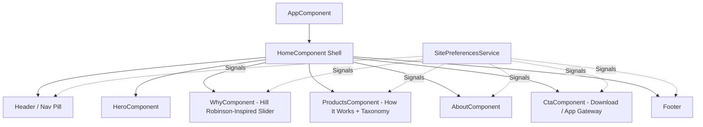

# Architecture Guide — Al Marsa Lookbook

## 1. System Overview

**Al Marsa (المرسى)** is designed as a high-performance, single-page luxury vessel-charter lookbook. The web application serves as the brand discovery tier, leading users to the official Al Marsa mobile apps for actual charter reservations, digital payments, Coastguard maritime permits, and KYC identity verification.

The application is built on **Angular 22.2** using **Zoneless change detection**, **standalone components**, and **Angular Signals**.



---

## 2. Core Architectural Pillars

### 2.1 Zoneless Angular & Signals
The application avoids `zone.js` runtime monkey-patching in favor of native Angular Signals and OnPush change detection:

```typescript
// Example: Reactive SitePreferencesService using Signals
@Injectable({ providedIn: 'root' })
export class SitePreferencesService {
  readonly locale = signal<Locale>(this.readInitialLocale());
  readonly theme = signal<Theme>(this.readInitialTheme());

  readonly isRtl = computed(() => this.locale() === 'ar');

  toggleLocale(): void {
    const nextLocale: Locale = this.locale() === 'en' ? 'ar' : 'en';
    this.locale.set(nextLocale);
    localStorage.setItem('marsa_locale', nextLocale);
    this.updateDocumentAttributes(nextLocale);
  }
}
```

### 2.2 Editorial Image-Led Slider Architecture (`WhyComponent`)
Inspired by Hill Robinson's *"Beyond management → What we do"* showcase, the Why Al Marsa section utilizes an image-driven horizontal scroll slider:

- **CSS Scroll-Snap**: Utilizes native CSS `scroll-snap-type: x mandatory` for fluid 60fps hardware-accelerated movement on desktop and mobile.
- **Aspect Ratio & Composition**: 3:4 portrait luxury photography with dark gradient overlays, typography anchors, and bilingual labels.
- **Interactive Drag & Velocity**: Custom pointer drag listeners calculate touch/mouse drag deltas and smoothly snap to adjacent cards.
- **RTL-Aware Physics**: Left/right arrow buttons and drag calculations automatically invert when Arabic (`dir="rtl"`) is active.
- **Accessible State**: `ResizeObserver` and scroll listeners update previous/next button disabled states and active indicator dots in real time.
- **Reduced Motion**: Honored via `window.matchMedia('(prefers-reduced-motion: reduce)')`, switching smooth animations to immediate jumps.

### 2.3 Single-Page Routing & Section Anchors
Rather than splitting a content-focused lookbook across multiple disjointed sub-routes, the router maps directly to page anchors (`#why`, `#how`, `#about`, `#download`):

```typescript
export const routes: Routes = [
  {
    path: '',
    loadComponent: () => import('./pages/home.component').then((m) => m.HomeComponent),
    pathMatch: 'full',
  },
  {
    path: 'services',
    redirectTo: '',
    data: { anchor: 'how' },
  },
  {
    path: '**',
    redirectTo: '',
  },
];
```

---

## 3. Directory & File Organization

```text
marsa/src/app/
├── components/
│   ├── layout/
│   │   ├── header/             # Floating navigation pill, locale & theme triggers
│   │   └── footer/             # Brand links, legal notices, dynamic copyright year
│   └── sections/
│       ├── hero/               # Cinematic video/image backdrop & primary CTA
│       ├── why/                # Image-led horizontal card slider (Hill Robinson design)
│       ├── products/           # 4-step booking workflow + 19 vessel categories
│       ├── about/              # Brand values, Saudi maritime vision & standards
│       └── cta/                # App ecosystem download banner
├── data/                       # Strongly typed bilingual data models
│   ├── why.data.ts             # Slider cards, imagery & localized blurbs
│   ├── how.data.ts             # Workflow steps & vessel category taxonomy
│   ├── about.data.ts           # Company history & vision
│   ├── footer.data.ts          # Navigation links & legal copy
│   └── hero.data.ts            # Hero headings, taglines & CTAs
├── models/                     # Shared TypeScript interfaces & types
├── pages/                      # Page layout shell (home.component.ts)
└── services/                   # Singleton reactive signals services
```

---

## 4. Design System & Styling Tokens

Styling is built with Tailwind CSS with custom palette extensions matching Gulf maritime elegance:

| Token Name | Value | Purpose |
| :--- | :--- | :--- |
| `marsa-navy` | `#081a1c` | Primary canvas & dark background |
| `marsa-sea` | `#0d2a2d` | Deep sea teal accents & header container |
| `marsa-sand` | `#e8d39c` | Warm sand gold for typography accents & borders |
| `marsa-pearl` | `#f8f6f0` | Light-mode background canvas |
| `marsa-ink` | `#0b1a1c` | High-contrast body text in light mode |

### Logical Properties
All layout dimensions, paddings, and margins leverage logical CSS properties (`ms-*`, `me-*`, `ps-*`, `pe-*`, `start-*`, `end-*`) to ensure seamless bidirectional mirroring between Arabic (RTL) and English (LTR).

---

## 5. Technical SEO & GEO (Generative Engine Optimization)

- **Semantic Hierarchy**: A single `<h1>` tag in the hero; sequential `<h2>` and `<h3>` tags throughout all sections.
- **Canonical Consistency**: Canonical URL `https://marsa-yacht.vercel.app/` synchronized with OpenGraph and Twitter cards.
- **Structured Data (JSON-LD)**: 
  - `Organization` schema declaring brand name, Arabic alternative name (`المرسى`), official website, and brand logo.
  - `WebSite` schema declaring lookbook purpose and canonical domain.
- **Truthful Content Strategy**: No fabricated inventory, fake pricing, or mock user reviews are included in structured markup or body text.

---

## 6. Testing Strategy

- **Unit Testing**: Powered by `@angular/build:unit-test` running **Vitest** in **jsdom** environments.
- **Component Specs**: Direct unit tests for navigation anchors, slider interaction math, locale switching, and button states.
- **Continuous Integration**: GitHub Actions validates typecheck, tests, and production build on every push and pull request.
